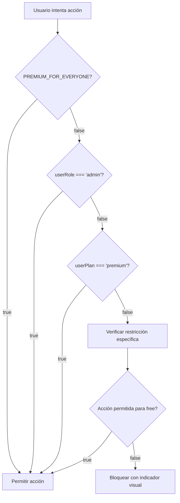

# Design Document: Freemium Plan Restrictions

## Overview

Este diseño implementa un modelo freemium en la aplicación Proclama, diferenciando entre usuarios gratuitos (Free) y premium (Premium). El sistema aplica restricciones específicas a funcionalidades clave mientras mantiene acceso completo a la biblioteca pública de canciones verificadas.

### Objetivos del Diseño

1. Implementar restricciones de plan sin degradar la experiencia de usuario
2. Mantener compatibilidad con el flag global `PREMIUM_FOR_EVERYONE` para control de despliegue
3. Proporcionar indicadores visuales claros de funcionalidades premium
4. Garantizar que administradores tengan acceso completo independientemente del plan
5. Separar almacenamiento local (Dexie) de sincronización en la nube (Supabase) según el plan

### Alcance

**Incluido:**
- Restricción de creación de canciones propias (límite de 10 para free)
- Bloqueo de búsqueda online Genius para usuarios free
- Restricción de sincronización en la nube para canciones propias de usuarios free
- Bloqueo de fondos multimedia (videos/imágenes) para usuarios free
- Componentes visuales para indicar restricciones
- Helpers en hook usePlan para verificación de permisos

**Excluido:**
- Sistema de pagos o suscripciones
- Interfaz de administración de planes
- Migración de datos existentes (se mantiene compatibilidad)
- Restricciones en funcionalidades de proyección básica

## Architecture

### Arquitectura de Permisos

El sistema de permisos se basa en una arquitectura de tres capas:

```
┌─────────────────────────────────────────────────────────────┐
│                    Presentation Layer                        │
│  (Componentes React con indicadores visuales)               │
│  - LibraryView, MediaPanel, OnlineSearchModal               │
└────────────────┬────────────────────────────────────────────┘
                 │
                 ▼
┌─────────────────────────────────────────────────────────────┐
│                    Permission Layer                          │
│  (Hook usePlan - Lógica de verificación de permisos)       │
│  - isPremium, canCreateSong, canUseGenius, canSync          │
└────────────────┬────────────────────────────────────────────┘
                 │
                 ▼
┌─────────────────────────────────────────────────────────────┐
│                    Data Layer                                │
│  (Almacenamiento condicional según plan)                    │
│  - Dexie (local) para todos                                 │
│  - Supabase (cloud) solo para premium                       │
└─────────────────────────────────────────────────────────────┘
```

### Flujo de Decisión de Permisos



### Estrategia de Almacenamiento

**Usuarios Free:**
- Canciones propias: Solo Dexie (local)
- Canciones públicas: Sincronizadas desde Supabase (solo lectura)
- Setlists: Solo Dexie (local)

**Usuarios Premium:**
- Canciones propias: Dexie + Supabase (sincronización bidireccional)
- Canciones públicas: Sincronizadas desde Supabase
- Setlists: Dexie + Supabase (sincronización bidireccional)

## Components and Interfaces

### 1. Hook usePlan (src/hooks/usePlan.ts)

**Responsabilidad:** Centralizar toda la lógica de verificación de permisos basada en plan.

**Interface:**

```typescript
interface UsePlanReturn {
  isPremium: boolean
  plan: 'free' | 'premium'
  canCreateSong: (ownSongCount: number) => boolean
  canUseGenius: boolean
  canSync: boolean
  canUseMediaBackgrounds: boolean
}

function usePlan(): UsePlanReturn
```

**Implementación:**

```typescript
export const FREE_SONG_LIMIT = 10

export function usePlan(): UsePlanReturn {
  const { userPlan, userRole } = useAppStore()

  // Determinar si el usuario es premium
  const isPremium =
    PREMIUM_FOR_EVERYONE ||
    userRole === 'admin' ||
    userPlan === 'premium'

  return {
    isPremium,
    plan: isPremium ? 'premium' : 'free',
    
    // Verificar si puede crear más canciones
    canCreateSong: (ownSongCount: number) =>
      isPremium || ownSongCount < FREE_SONG_LIMIT,
    
    // Búsqueda online Genius
    canUseGenius: isPremium,
    
    // Sincronización en la nube
    canSync: isPremium,
    
    // Fondos multimedia (videos/imágenes)
    canUseMediaBackgrounds: isPremium,
  }
}
```

### 2. Modificaciones en LibraryView (src/pages/LibraryView.tsx)

**Cambios necesarios:**

1. Ya implementado: Uso de `canCreateSong` para deshabilitar botón "Nueva canción"
2. Ya implementado: Uso de `canUseGenius` para deshabilitar botón "Buscar online"
3. Mejora: Asegurar que el conteo `ownSongCount` solo incluya canciones del usuario actual

**Código existente a mantener:**

```typescript
const { canCreateSong, canUseGenius } = usePlan()

const ownSongCount = useLiveQuery(async () => {
  if (!user?.id) return 0
  return db.songs.where('userId').equals(user.id).count()
}, [user?.id]) ?? 0
```

### 3. Modificaciones en OnlineSearchModal (src/components/OnlineSearchModal.tsx)

**Cambios necesarios:**

1. Ya implementado: Verificación de `canUseGenius` al inicio del modal
2. Ya implementado: Mensaje visual cuando la función está bloqueada
3. Mejora: Asegurar que el guardado de canciones respete `canSync`

**Lógica de guardado a modificar:**

```typescript
const handleSave = async () => {
  if (!importedLyrics) return
  const { song, lyrics } = importedLyrics
  const { canSync } = usePlan()
  
  setSaving(true)
  try {
    const now = new Date()
    const payload = {
      userId: user?.id,
      title: song.title,
      artist: song.artist,
      lyrics,
      key: '',
      tags: [],
      language: 'Español',
      usageCount: 0,
      isPublic: user ? isPublic : false,
      isVerified: userRole === 'admin' ? isPublic : false,
      createdAt: now,
      updatedAt: now,
      sourceUrl: song.url
    }
    
    // Solo sincronizar con Supabase si el usuario puede
    if (canSync && user) {
      const created = await createSong(payload)
      if (created) {
        await db.songs.add(created)
      } else {
        await db.songs.add(payload)
      }
    } else {
      // Usuario free: solo guardar localmente
      await db.songs.add(payload)
    }
    
    onClose()
  } catch (err) {
    console.error(err)
    setError('Error al guardar la canción.')
  } finally {
    setSaving(false)
    setImportedLyrics(null)
  }
}
```

### 4. Modificaciones en MediaPanel (src/components/MediaPanel.tsx)

**Cambios necesarios:**

1. Importar y usar `usePlan` hook
2. Bloquear carga de archivos multimedia para usuarios free
3. Mostrar mensaje informativo sobre restricción
4. Mantener funcionalidad de fondos de color sólido para todos

**Implementación:**

```typescript
import { usePlan } from '@/hooks/usePlan'

export default function MediaPanel() {
  const { canUseMediaBackgrounds } = usePlan()
  
  // Bloquear procesamiento de archivos si no es premium
  const processFiles = (files: File[]) => {
    if (!canUseMediaBackgrounds) {
      setError('Los fondos multimedia son una función premium. Actualiza tu plan para acceder.')
      return
    }
    
    // ... resto de la lógica existente
  }
  
  // Renderizado condicional
  return (
    <div className="media-panel">
      <div className="recognition-header">
        <div style={{ display: 'flex', alignItems: 'center', gap: 6 }}>
          <MonitorPlay size={14} /> Anuncios / Media Local
          {!canUseMediaBackgrounds && <Lock size={12} style={{ marginLeft: 4, opacity: 0.7 }} />}
        </div>
      </div>
      
      {!canUseMediaBackgrounds ? (
        <div className="premium-feature-notice">
          <Lock size={24} color="var(--gold)" style={{ opacity: 0.7 }} />
          <h3>Función Premium</h3>
          <p>Los fondos multimedia (videos e imágenes) están disponibles en el plan Premium.</p>
          <p className="hint">Puedes usar fondos de color sólido y gradientes en el panel de temas.</p>
        </div>
      ) : (
        // ... renderizado normal del panel de media
      )}
    </div>
  )
}
```

### 5. Modificaciones en supabase.ts (src/services/supabase.ts)

**Cambios necesarios:**

Las funciones `createSong` y `updateSong` deben ser llamadas condicionalmente desde los componentes según `canSync`. No se modifica supabase.ts directamente, sino que los componentes verifican el permiso antes de llamar estas funciones.

**Patrón de uso en componentes:**

```typescript
// En SongEditor o cualquier componente que guarde canciones
const { canSync } = usePlan()

const handleSave = async (songData: Song) => {
  // Siempre guardar localmente
  await db.songs.add(songData)
  
  // Solo sincronizar si tiene permiso
  if (canSync && user) {
    await createSong(songData)
  }
}
```

### 6. Componente de Indicador de Restricción (Nuevo)

**Ubicación:** Inline en componentes (no se crea archivo separado para mantener simplicidad)

**Patrón de uso:**

```typescript
// Botón con restricción
<button
  disabled={!canUseFeature}
  title={!canUseFeature ? 'Función premium — actualiza tu plan' : undefined}
>
  <Icon size={15} /> Acción
  {!canUseFeature && <Lock size={12} style={{ marginLeft: 4, opacity: 0.7 }} />}
</button>

// Mensaje de bloqueo en modal
{!canUseFeature && (
  <div className="premium-feature-notice">
    <Lock size={24} color="var(--gold)" style={{ opacity: 0.7 }} />
    <h3>Función Premium</h3>
    <p>Esta funcionalidad está disponible en el plan Premium.</p>
  </div>
)}
```

## Data Models

No se requieren cambios en los modelos de datos existentes. El sistema utiliza los tipos ya definidos en `src/types/index.ts`:

```typescript
interface Song {
  id?: number
  userId?: string
  // ... campos existentes
}
```

**Campos relevantes para restricciones:**

- `userId`: Identifica al propietario de la canción (usado para contar canciones propias)
- `isPublic`: Indica si la canción es pública (las públicas verificadas son accesibles para todos)
- `isVerified`: Indica si la canción está verificada (solo verificadas aparecen en biblioteca pública)

**Store State (src/stores/index.ts):**

```typescript
interface AppStore {
  userPlan: 'free' | 'premium'  // Ya existe
  userRole: 'admin' | 'user' | null  // Ya existe
  // ... otros campos
}
```

No se requieren campos adicionales en el store.


## Correctness Properties

*A property is a characteristic or behavior that should hold true across all valid executions of a system—essentially, a formal statement about what the system should do. Properties serve as the bridge between human-readable specifications and machine-verifiable correctness guarantees.*

### Property 1: Public Library Access

*For any* user (regardless of plan or role), all songs with `isPublic=true` and `isVerified=true` should be accessible for loading and projection.

**Validates: Requirements 1.1, 1.2**

### Property 2: Free User Song Creation Limit

*For any* free user (non-premium, non-admin) with `ownSongCount >= 10`, the function `canCreateSong(ownSongCount)` should return `false`.

**Validates: Requirements 2.1, 2.5**

### Property 3: Premium User Unlimited Songs

*For any* premium user or administrator, the function `canCreateSong(ownSongCount)` should return `true` for any value of `ownSongCount`.

**Validates: Requirements 2.4, 2.5**

### Property 4: New Song Button State

*For any* user state where `canCreateSong(ownSongCount)` returns `false`, the "Nueva canción" button should have the `disabled` attribute set to `true`.

**Validates: Requirements 2.2**

### Property 5: Media Background Restrictions

*For any* free user (non-premium, non-admin), the function `canUseMediaBackgrounds` should return `false`, and for any premium user or administrator, it should return `true`.

**Validates: Requirements 3.1, 3.4**

### Property 6: Gradient Backgrounds Unrestricted

*For any* user (regardless of plan or role), gradient backgrounds should be available and functional in the theme settings.

**Validates: Requirements 3.5**

### Property 7: Genius Search Restrictions

*For any* free user (non-premium, non-admin), the function `canUseGenius` should return `false`, and for any premium user or administrator, it should return `true`.

**Validates: Requirements 4.1, 4.4, 4.5**

### Property 8: Cloud Sync Restrictions

*For any* free user (non-premium, non-admin), the function `canSync` should return `false`, and for any premium user or administrator, it should return `true`.

**Validates: Requirements 5.1, 5.4, 5.5**

### Property 9: Local-Only Storage for Free Users

*For any* free user creating or editing a song, the song data should be saved to Dexie (local storage) and should not trigger a call to Supabase `createSong` or `updateSong` functions.

**Validates: Requirements 5.1**

### Property 10: Cloud Sync for Premium Users

*For any* premium user or administrator creating or editing a song, the song data should be saved to both Dexie (local storage) and Supabase (cloud storage).

**Validates: Requirements 5.4**

### Property 11: Admin Always Premium

*For any* user with `userRole === 'admin'`, the function `isPremium` should return `true` regardless of the value of `userPlan`.

**Validates: Requirements 6.1, 6.6**

### Property 12: Plan Value Correctness

*For any* user, the `plan` property should return `'premium'` if `isPremium` is `true`, and `'free'` if `isPremium` is `false`.

**Validates: Requirements 6.2**

### Property 13: PREMIUM_FOR_EVERYONE Override

*For any* user, when the flag `PREMIUM_FOR_EVERYONE` is `true`, the function `isPremium` should return `true` regardless of `userPlan` or `userRole`.

**Validates: Requirements 8.2**

### Property 14: Plan-Based Restrictions When Flag Disabled

*For any* user, when the flag `PREMIUM_FOR_EVERYONE` is `false`, the restrictions should be applied based on `userPlan` and `userRole` (free users should have `isPremium === false` unless they are admins).

**Validates: Requirements 8.3**

## Error Handling

### Validation Errors

**Scenario:** Usuario free intenta crear canción número 11

**Handling:**
- El botón "Nueva canción" debe estar deshabilitado visualmente
- Si de alguna forma se intenta la creación (ej. manipulación de DOM), el sistema debe validar en el handler y prevenir la acción
- Mostrar mensaje informativo: "Límite de 10 canciones alcanzado. Actualiza a Premium para canciones ilimitadas."

**Scenario:** Usuario free intenta cargar fondos multimedia

**Handling:**
- El panel de media debe mostrar un mensaje de restricción en lugar de la zona de carga
- Si se intenta cargar archivos (ej. drag & drop), mostrar error: "Los fondos multimedia son una función premium."
- Sugerir alternativas: "Puedes usar fondos de color sólido y gradientes en el panel de temas."

**Scenario:** Usuario free intenta usar búsqueda Genius

**Handling:**
- El botón "Buscar online" debe estar deshabilitado con icono de candado
- Al hacer clic, el modal debe mostrar mensaje de restricción en lugar de la interfaz de búsqueda
- Mensaje: "La búsqueda online de letras está disponible para usuarios Premium."

### Network Errors

**Scenario:** Fallo al sincronizar con Supabase (usuario premium)

**Handling:**
- Guardar datos localmente en Dexie como fallback
- Mostrar notificación: "Guardado localmente. La sincronización se reintentará cuando haya conexión."
- Implementar retry logic en background

**Scenario:** Fallo al cargar canciones públicas desde Supabase

**Handling:**
- Usar datos en caché de Dexie si están disponibles
- Mostrar mensaje: "No se pudo sincronizar con la biblioteca pública. Usando datos locales."
- Permitir continuar con funcionalidad reducida

### State Inconsistencies

**Scenario:** Usuario cambia de plan (free → premium) durante la sesión

**Handling:**
- El hook `usePlan` debe reaccionar a cambios en `userPlan` del store
- Los componentes que usan `usePlan` se re-renderizarán automáticamente
- No se requiere recarga de página

**Scenario:** Flag PREMIUM_FOR_EVERYONE cambia durante desarrollo

**Handling:**
- Requiere recarga de la aplicación (es una constante, no reactiva)
- En producción, este flag no debería cambiar dinámicamente

## Testing Strategy

### Dual Testing Approach

Este feature requiere tanto unit tests como property-based tests para garantizar cobertura completa:

**Unit Tests:** Verificarán casos específicos, ejemplos concretos y comportamiento de UI
**Property Tests:** Verificarán propiedades universales a través de múltiples combinaciones de entrada

### Unit Testing Focus

Los unit tests se enfocarán en:

1. **Casos específicos de UI:**
   - Botón "Nueva canción" deshabilitado cuando `ownSongCount === 10` para usuario free
   - Icono de candado presente en botón "Buscar online" para usuario free
   - Mensaje de restricción visible en MediaPanel para usuario free
   - Tooltips con mensajes apropiados en botones deshabilitados

2. **Ejemplos de integración:**
   - Guardar canción como usuario free solo actualiza Dexie, no Supabase
   - Guardar canción como usuario premium actualiza ambos Dexie y Supabase
   - Cargar canción pública como usuario free funciona correctamente

3. **Edge cases:**
   - Usuario con exactamente 10 canciones puede cargar pero no crear nueva
   - Administrador con `userPlan='free'` tiene acceso premium
   - Flag `PREMIUM_FOR_EVERYONE=true` otorga acceso a usuario con `userPlan='free'`

4. **Accesibilidad:**
   - Botones deshabilitados tienen `aria-label` descriptivo
   - Mensajes de error son anunciados por lectores de pantalla (`role="alert"`)

### Property-Based Testing Configuration

**Library:** fast-check (para TypeScript/JavaScript)

**Configuration:**
- Mínimo 100 iteraciones por test
- Generadores personalizados para tipos de usuario (free, premium, admin)
- Generadores para conteos de canciones (0-20 rango)

**Property Tests a Implementar:**

#### Test 1: Public Library Access Property
```typescript
// Feature: freemium-plan-restrictions, Property 1: Public library access
it('should allow all users to access public verified songs', () => {
  fc.assert(
    fc.property(
      fc.record({
        userPlan: fc.constantFrom('free', 'premium'),
        userRole: fc.constantFrom('admin', 'user', null),
        song: fc.record({
          isPublic: fc.constant(true),
          isVerified: fc.constant(true),
          // ... otros campos
        })
      }),
      ({ userPlan, userRole, song }) => {
        // Setup: configurar store con userPlan y userRole
        // Action: intentar cargar canción
        // Assert: canción debe ser accesible
      }
    ),
    { numRuns: 100 }
  )
})
```

#### Test 2: Song Creation Limit Property
```typescript
// Feature: freemium-plan-restrictions, Property 2: Free user song creation limit
it('should prevent free users from creating songs when limit reached', () => {
  fc.assert(
    fc.property(
      fc.integer({ min: 10, max: 20 }),
      (ownSongCount) => {
        // Setup: usuario free con ownSongCount canciones
        const { canCreateSong } = usePlan()
        // Assert: canCreateSong debe retornar false
        expect(canCreateSong(ownSongCount)).toBe(false)
      }
    ),
    { numRuns: 100 }
  )
})
```

#### Test 3: Premium Unlimited Songs Property
```typescript
// Feature: freemium-plan-restrictions, Property 3: Premium user unlimited songs
it('should allow premium users to create unlimited songs', () => {
  fc.assert(
    fc.property(
      fc.integer({ min: 0, max: 1000 }),
      fc.constantFrom('premium', 'admin'),
      (ownSongCount, userType) => {
        // Setup: usuario premium o admin con cualquier ownSongCount
        const { canCreateSong } = usePlan()
        // Assert: canCreateSong debe retornar true
        expect(canCreateSong(ownSongCount)).toBe(true)
      }
    ),
    { numRuns: 100 }
  )
})
```

#### Test 4: Media Background Restrictions Property
```typescript
// Feature: freemium-plan-restrictions, Property 5: Media background restrictions
it('should restrict media backgrounds based on plan', () => {
  fc.assert(
    fc.property(
      fc.record({
        userPlan: fc.constantFrom('free', 'premium'),
        userRole: fc.constantFrom('admin', 'user', null)
      }),
      ({ userPlan, userRole }) => {
        // Setup: configurar store
        const { canUseMediaBackgrounds, isPremium } = usePlan()
        // Assert: canUseMediaBackgrounds debe igualar isPremium
        expect(canUseMediaBackgrounds).toBe(isPremium)
      }
    ),
    { numRuns: 100 }
  )
})
```

#### Test 5: Genius Search Restrictions Property
```typescript
// Feature: freemium-plan-restrictions, Property 7: Genius search restrictions
it('should restrict Genius search based on plan', () => {
  fc.assert(
    fc.property(
      fc.record({
        userPlan: fc.constantFrom('free', 'premium'),
        userRole: fc.constantFrom('admin', 'user', null)
      }),
      ({ userPlan, userRole }) => {
        // Setup: configurar store
        const { canUseGenius, isPremium } = usePlan()
        // Assert: canUseGenius debe igualar isPremium
        expect(canUseGenius).toBe(isPremium)
      }
    ),
    { numRuns: 100 }
  )
})
```

#### Test 6: Cloud Sync Restrictions Property
```typescript
// Feature: freemium-plan-restrictions, Property 8: Cloud sync restrictions
it('should restrict cloud sync based on plan', () => {
  fc.assert(
    fc.property(
      fc.record({
        userPlan: fc.constantFrom('free', 'premium'),
        userRole: fc.constantFrom('admin', 'user', null)
      }),
      ({ userPlan, userRole }) => {
        // Setup: configurar store
        const { canSync, isPremium } = usePlan()
        // Assert: canSync debe igualar isPremium
        expect(canSync).toBe(isPremium)
      }
    ),
    { numRuns: 100 }
  )
})
```

#### Test 7: Admin Always Premium Property
```typescript
// Feature: freemium-plan-restrictions, Property 11: Admin always premium
it('should treat admins as premium regardless of plan', () => {
  fc.assert(
    fc.property(
      fc.constantFrom('free', 'premium'),
      (userPlan) => {
        // Setup: usuario admin con cualquier plan
        // userRole = 'admin'
        const { isPremium } = usePlan()
        // Assert: isPremium debe ser true
        expect(isPremium).toBe(true)
      }
    ),
    { numRuns: 100 }
  )
})
```

#### Test 8: PREMIUM_FOR_EVERYONE Override Property
```typescript
// Feature: freemium-plan-restrictions, Property 13: PREMIUM_FOR_EVERYONE override
it('should grant premium access to all when flag is true', () => {
  fc.assert(
    fc.property(
      fc.record({
        userPlan: fc.constantFrom('free', 'premium'),
        userRole: fc.constantFrom('admin', 'user', null)
      }),
      ({ userPlan, userRole }) => {
        // Setup: PREMIUM_FOR_EVERYONE = true
        const { isPremium } = usePlan()
        // Assert: isPremium debe ser true para todos
        expect(isPremium).toBe(true)
      }
    ),
    { numRuns: 100 }
  )
})
```

### Test Organization

```
tests/
├── unit/
│   ├── hooks/
│   │   └── usePlan.test.ts
│   ├── components/
│   │   ├── LibraryView.test.tsx
│   │   ├── MediaPanel.test.tsx
│   │   └── OnlineSearchModal.test.tsx
│   └── services/
│       └── supabase.test.ts
└── property/
    ├── plan-permissions.property.test.ts
    ├── song-creation.property.test.ts
    └── storage-sync.property.test.ts
```

### Coverage Goals

- **Unit Tests:** 90%+ coverage en componentes modificados
- **Property Tests:** 100% de propiedades de correctness implementadas
- **Integration Tests:** Flujos completos de usuario (free y premium)

### Testing Tools

- **Test Runner:** Vitest
- **Property Testing:** fast-check
- **Component Testing:** React Testing Library
- **Mocking:** vi.mock para Supabase y Dexie

