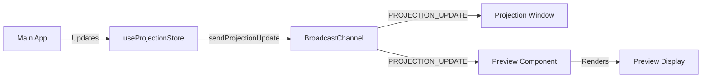

# Design Document: Projection Preview Window

## Overview

The Projection Preview Window is a fixed UI component that displays real-time projection content at the bottom of the main application. This feature enables worship leaders and operators to monitor what is being projected without switching views or looking at the physical projector screen, significantly improving workflow efficiency and reducing errors during live presentations.

The preview window integrates seamlessly with the existing projection system, subscribing to the same BroadcastChannel messages that synchronize the main application with the projection window. It displays a scaled-down version of the current slide, including text, backgrounds, media, and countdown timers, while maintaining visual consistency with the application's dark theme.

Key capabilities:
- Real-time synchronization with projection state via BroadcastChannel
- Collapsible interface to maximize screen space when not needed
- Global visibility across all application views (library, setlists, bible, etc.)
- Performance-optimized rendering with minimal resource consumption
- Responsive layout that adapts to sidebar and control panel visibility

## Architecture

### Component Structure

```
App.tsx (MainApp)
├── Sidebar
├── Main Content (LibraryView, BibleView, etc.)
├── ControlPanel (right panel)
└── ProjectionPreview (NEW - fixed bottom component)
```

The `ProjectionPreview` component will be added as a sibling to the existing layout components within the `MainApp` function. It will be positioned using CSS fixed positioning to remain visible across all views.

### State Management

The preview window will primarily consume state from the existing `useProjectionStore` Zustand store. No new global state is required, but the component will maintain local state for:

- `isCollapsed`: Boolean tracking the collapsed/expanded state of the preview
- `previewState`: Local copy of ProjectionState for rendering (synchronized via BroadcastChannel)

The collapsed state will be persisted to localStorage using a simple key-value approach:

```typescript
const STORAGE_KEY = 'proclama-preview-collapsed'
```

### Communication Flow



The preview component subscribes to the same BroadcastChannel (`proclama-projection`) used by the projection window, ensuring perfect synchronization without additional complexity.

### Rendering Strategy

The preview will use a scaled-down rendering approach:

1. **Container**: Fixed aspect ratio (16:9) container with max height of 200px when expanded
2. **Content Scaling**: CSS `transform: scale()` to proportionally reduce projection content
3. **Background Rendering**: Simplified background rendering (static images, no video playback in preview)
4. **Text Rendering**: Same font family and styling as projection, scaled proportionally

## Components and Interfaces

### New Component: ProjectionPreview

**Location**: `src/components/ProjectionPreview.tsx`

**Props**: None (reads from global store)

**Internal State**:
```typescript
interface PreviewState {
  isCollapsed: boolean
  projectionState: ProjectionState | null
}
```

**Key Methods**:
- `toggleCollapse()`: Toggles the collapsed state and persists to localStorage
- `handleProjectionUpdate(state: ProjectionState)`: Updates local state when BroadcastChannel message received
- `renderSlideContent()`: Renders the current slide with appropriate scaling
- `renderCountdownContent()`: Renders countdown timer when active

### Modified Component: App.tsx (MainApp)

The `MainApp` function will be updated to include the `ProjectionPreview` component:

```typescript
function MainApp() {
  useKeyboardShortcuts()
  const { activeView, isSidebarOpen, onboardingDone } = useAppStore(...)

  return (
    <div className={`app-shell ${!isSidebarOpen ? 'sidebar-hidden' : ''}`}>
      {!onboardingDone && <OnboardingFlow />}
      <Sidebar />
      <main className="main-content">
        {/* Existing view components */}
      </main>
      <aside className="right-panel">
        <ControlPanel />
      </aside>
      <ProjectionPreview /> {/* NEW */}
    </div>
  )
}
```

### CSS Styling

**New CSS Classes** (to be added to `src/index.css`):

```css
.projection-preview {
  position: fixed;
  bottom: 0;
  left: 0;
  right: 0;
  z-index: 100;
  background: #060810;
  border-top: 1px solid rgba(255, 255, 255, 0.1);
  transition: height 0.3s ease;
}

.projection-preview.collapsed {
  height: 40px;
}

.projection-preview.expanded {
  height: 200px;
}

.projection-preview-header {
  display: flex;
  align-items: center;
  justify-content: space-between;
  padding: 8px 16px;
  height: 40px;
  background: rgba(0, 0, 0, 0.3);
}

.projection-preview-content {
  position: relative;
  width: 100%;
  height: calc(100% - 40px);
  display: flex;
  align-items: center;
  justify-content: center;
  overflow: hidden;
}

.projection-preview-viewport {
  position: relative;
  width: 100%;
  max-width: 284px; /* 16:9 aspect ratio at 160px height */
  aspect-ratio: 16 / 9;
  background: #000;
  overflow: hidden;
  border-radius: 4px;
}
```

### Integration Points

1. **BroadcastChannel Subscription**: The preview component will call `onMessage()` from `src/services/projection.ts` to subscribe to projection updates
2. **Store Access**: Read-only access to `useProjectionStore` for initial state and theme information
3. **Layout Adjustment**: The main content area will need `padding-bottom` adjustment when preview is expanded to prevent content from being hidden behind the preview

## Data Models

No new data models are required. The component will use existing types:

### Existing Types (from `src/types/index.ts`)

```typescript
interface ProjectionState {
  songId: number | null
  songTitle: string
  slides: Slide[]
  currentSlide: number
  isBible?: boolean
  theme: ProjectionTheme
  media?: {
    url: string
    type: 'image' | 'video'
    isBackgroundMode?: boolean
  } | null
  hideText?: boolean
  mediaStatus?: {
    currentTime: number
    duration: number
    isPlaying: boolean
  }
}

interface Slide {
  index: number
  label: string
  lines: string[]
}

interface ProjectionTheme {
  background: string
  backgroundType?: 'color' | 'video' | 'image' | 'gradient'
  backgroundImageUrl?: string
  backgroundVideoUrl?: string
  backgroundBlur?: number
  backgroundOverlayOpacity?: number
  fontFamily: string
  fontSize: number
  textColor: string
  textShadow: boolean
  showTitle: boolean
  showVerseLabel: boolean
  titlePosition?: 'top' | 'bottom' | 'none'
  verseReferencePosition?: 'top' | 'bottom'
  textUppercase?: boolean
}

interface CountdownState {
  config: CountdownConfig
  status: 'idle' | 'running' | 'paused' | 'finished'
  remainingTime: number
}
```

### Local Storage Schema

```typescript
// Key: 'proclama-preview-collapsed'
// Value: 'true' | 'false'
```


## Correctness Properties

*A property is a characteristic or behavior that should hold true across all valid executions of a system—essentially, a formal statement about what the system should do. Properties serve as the bridge between human-readable specifications and machine-verifiable correctness guarantees.*

### Property Reflection

After analyzing all acceptance criteria, I identified the following testable properties. During reflection, I combined redundant properties and eliminated those that were logically implied by others:

**Redundancies Eliminated:**
- Requirements 2.1-2.7 all test the same behavior (visibility across views) and were combined into Property 1
- Requirements 4.2 and 4.4 test opposite state transitions and were combined into Property 3 (toggle round-trip)
- Requirements 4.5 and 4.6 test persistence write and read, combined into Property 4 (persistence round-trip)
- Requirements 8.1 and 8.2 both test slide indicator display and were combined into Property 8
- Requirements 6.4, 6.5, and 6.6 all test projection state synchronization and were combined into Property 6

### Property 1: Preview visibility across all views

*For any* valid activeView value ('library', 'editor', 'setlists', 'bible', 'settings', 'countdown', 'notes', 'terms'), the ProjectionPreview component should be rendered in the DOM.

**Validates: Requirements 2.1, 2.2, 2.3, 2.4, 2.5, 2.6, 2.7**

### Property 2: Projection state synchronization

*For any* ProjectionState received via BroadcastChannel PROJECTION_UPDATE message, the preview component's local state should update to match the received state within a reasonable time frame.

**Validates: Requirements 1.1, 6.2**

### Property 3: Collapse toggle round-trip

*For any* collapsed state (true or false), clicking the collapse toggle should invert the state, and clicking again should return to the original state.

**Validates: Requirements 4.2, 4.4**

### Property 4: Collapsed state persistence round-trip

*For any* collapsed state value (true or false), storing it to localStorage and then reading it back should return the same value.

**Validates: Requirements 4.5, 4.6**

### Property 5: HideText conditional rendering

*For any* ProjectionState where hideText is true, the preview should not render text content (slide lines, title, labels) but should render background and media elements.

**Validates: Requirements 1.5**

### Property 6: Projection state changes trigger preview updates

*For any* change to ProjectionState properties (currentSlide, theme, media), the preview display should update to reflect the new state.

**Validates: Requirements 6.4, 6.5, 6.6**

### Property 7: Media content display

*For any* ProjectionState where media is not null, the preview should render an img or video element with the media URL.

**Validates: Requirements 1.4**

### Property 8: Slide indicator formatting

*For any* ProjectionState with slides.length > 0, the slide indicator should display in the format "{currentSlide + 1} / {slides.length}".

**Validates: Requirements 8.1, 8.2, 8.3**

### Property 9: Countdown timer formatting

*For any* remainingTime value in seconds, the displayed countdown should be formatted as "MM:SS" where MM is zero-padded minutes and SS is zero-padded seconds.

**Validates: Requirements 9.3**

### Property 10: Countdown conditional rendering

*For any* CountdownState where status is 'running', 'paused', or 'finished', the preview should display countdown content instead of regular projection content.

**Validates: Requirements 9.1, 9.4, 9.5, 9.6**

### Property 11: Countdown title conditional display

*For any* CountdownState where config.title is a non-empty string, the preview should display the title above the timer.

**Validates: Requirements 9.2**

### Property 12: Aspect ratio maintenance

*For any* preview viewport dimensions, the computed aspect ratio (width / height) should equal 16/9 (approximately 1.778) within a small tolerance (±0.01).

**Validates: Requirements 1.6**

### Property 13: Collapse toggle icon state

*For any* collapsed state value, the collapse toggle should display a chevron-down icon when collapsed is true, and a chevron-up icon when collapsed is false.

**Validates: Requirements 4.7**

### Property 14: Song title header display

*For any* ProjectionState where songTitle is a non-empty string, the preview header should display the song title.

**Validates: Requirements 5.6**

### Property 15: Projection state content consistency

*For any* ProjectionState, the preview should render the same slide content (text, background type, theme properties) as would be rendered in the ProjectionWindow component.

**Validates: Requirements 1.2**


## Error Handling

### BroadcastChannel Communication Errors

**Scenario**: BroadcastChannel is not supported in the browser (older browsers)

**Handling**: 
- Graceful degradation: Preview component will still render using state from `useProjectionStore`
- Display a warning message in the preview header: "Preview may not be synchronized"
- Component should not crash or prevent application from loading

**Implementation**:
```typescript
try {
  const channel = getChannel()
  const unsubscribe = onMessage(handleProjectionUpdate)
  return unsubscribe
} catch (error) {
  console.warn('BroadcastChannel not supported, preview will use store state only')
  setShowSyncWarning(true)
}
```

### LocalStorage Errors

**Scenario**: localStorage is not available (private browsing, storage quota exceeded)

**Handling**:
- Catch errors when reading/writing collapsed state
- Fall back to default state (expanded)
- Component continues to function without persistence

**Implementation**:
```typescript
const loadCollapsedState = (): boolean => {
  try {
    const stored = localStorage.getItem(STORAGE_KEY)
    return stored === 'true'
  } catch (error) {
    console.warn('localStorage not available, using default state')
    return false // default to expanded
  }
}

const saveCollapsedState = (collapsed: boolean): void => {
  try {
    localStorage.setItem(STORAGE_KEY, String(collapsed))
  } catch (error) {
    console.warn('Failed to persist preview state')
  }
}
```

### Invalid Projection State

**Scenario**: Received ProjectionState has missing or malformed data

**Handling**:
- Validate received state before updating component state
- Use default values for missing properties
- Display empty state if critical data is missing (slides array)

**Implementation**:
```typescript
const validateProjectionState = (state: any): ProjectionState | null => {
  if (!state || typeof state !== 'object') return null
  
  return {
    songId: state.songId ?? null,
    songTitle: state.songTitle ?? '',
    slides: Array.isArray(state.slides) ? state.slides : [],
    currentSlide: typeof state.currentSlide === 'number' ? state.currentSlide : 0,
    theme: state.theme ?? DEFAULT_THEME,
    media: state.media ?? null,
    hideText: state.hideText ?? false,
    isBible: state.isBible ?? false
  }
}
```

### Media Loading Errors

**Scenario**: Image or video URL fails to load

**Handling**:
- Display a placeholder or fallback background color
- Log error to console for debugging
- Do not crash the preview component

**Implementation**:
```typescript
 {
    console.warn('Failed to load preview media:', media.url)
    e.currentTarget.style.display = 'none'
  }}
  alt="Preview media"
/>
```

### Countdown State Errors

**Scenario**: CountdownState has invalid remainingTime (negative or NaN)

**Handling**:
- Clamp remainingTime to valid range (0 to max duration)
- Display "00:00" for invalid values
- Continue rendering other countdown elements

**Implementation**:
```typescript
const formatTime = (totalSeconds: number): string => {
  const clamped = Math.max(0, Math.floor(totalSeconds))
  const m = Math.floor(clamped / 60)
  const s = clamped % 60
  return `${m.toString().padStart(2, '0')}:${s.toString().padStart(2, '0')}`
}
```

## Testing Strategy

### Dual Testing Approach

This feature will use both unit tests and property-based tests to ensure comprehensive coverage:

- **Unit tests**: Verify specific examples, edge cases, component rendering, and integration points
- **Property tests**: Verify universal properties across all inputs using randomized test data

### Property-Based Testing

**Library**: fast-check (already in package.json)

**Configuration**: Each property test will run a minimum of 100 iterations to ensure comprehensive input coverage.

**Test Tagging**: Each property test will include a comment referencing the design document property:

```typescript
// Feature: projection-preview-window, Property 1: Preview visibility across all views
```

### Property Test Implementations

#### Property 1: Preview visibility across all views

```typescript
import fc from 'fast-check'
import { render } from '@testing-library/react'

// Feature: projection-preview-window, Property 1: Preview visibility across all views
test('preview is visible for all valid activeView values', () => {
  const validViews = fc.constantFrom(
    'library', 'editor', 'setlists', 'bible', 
    'settings', 'countdown', 'notes', 'terms'
  )
  
  fc.assert(
    fc.property(validViews, (activeView) => {
      const { container } = render(<MainApp />)
      // Mock useAppStore to return the activeView
      const preview = container.querySelector('.projection-preview')
      expect(preview).toBeInTheDocument()
    }),
    { numRuns: 100 }
  )
})
```

#### Property 3: Collapse toggle round-trip

```typescript
// Feature: projection-preview-window, Property 3: Collapse toggle round-trip
test('toggling collapse twice returns to original state', () => {
  fc.assert(
    fc.property(fc.boolean(), (initialCollapsed) => {
      const { getByRole } = render(<ProjectionPreview />)
      // Set initial state
      const toggle = getByRole('button', { name: /collapse|expand/i })
      
      // Click twice
      fireEvent.click(toggle)
      fireEvent.click(toggle)
      
      // Should return to initial state
      const finalState = /* read component state */
      expect(finalState).toBe(initialCollapsed)
    }),
    { numRuns: 100 }
  )
})
```

#### Property 4: Collapsed state persistence round-trip

```typescript
// Feature: projection-preview-window, Property 4: Collapsed state persistence round-trip
test('collapsed state persists to localStorage and restores correctly', () => {
  fc.assert(
    fc.property(fc.boolean(), (collapsed) => {
      // Write to localStorage
      localStorage.setItem('proclama-preview-collapsed', String(collapsed))
      
      // Read back
      const restored = localStorage.getItem('proclama-preview-collapsed') === 'true'
      
      expect(restored).toBe(collapsed)
    }),
    { numRuns: 100 }
  )
})
```

#### Property 8: Slide indicator formatting

```typescript
// Feature: projection-preview-window, Property 8: Slide indicator formatting
test('slide indicator formats as "N / Total" for any valid slide state', () => {
  const slideStateGen = fc.record({
    currentSlide: fc.nat(99),
    totalSlides: fc.integer({ min: 1, max: 100 })
  }).filter(({ currentSlide, totalSlides }) => currentSlide < totalSlides)
  
  fc.assert(
    fc.property(slideStateGen, ({ currentSlide, totalSlides }) => {
      const { container } = render(<ProjectionPreview />)
      // Mock projection state with slides
      
      const indicator = container.querySelector('.projection-preview-indicator')
      const expected = `${currentSlide + 1} / ${totalSlides}`
      expect(indicator?.textContent).toBe(expected)
    }),
    { numRuns: 100 }
  )
})
```

#### Property 9: Countdown timer formatting

```typescript
// Feature: projection-preview-window, Property 9: Countdown timer formatting
test('countdown timer formats as MM:SS for any valid time value', () => {
  fc.assert(
    fc.property(fc.integer({ min: 0, max: 3599 }), (seconds) => {
      const formatted = formatTime(seconds)
      
      // Should match MM:SS pattern
      expect(formatted).toMatch(/^\d{2}:\d{2}$/)
      
      // Verify correctness
      const [mm, ss] = formatted.split(':').map(Number)
      expect(mm).toBe(Math.floor(seconds / 60))
      expect(ss).toBe(seconds % 60)
    }),
    { numRuns: 100 }
  )
})
```

#### Property 12: Aspect ratio maintenance

```typescript
// Feature: projection-preview-window, Property 12: Aspect ratio maintenance
test('preview viewport maintains 16:9 aspect ratio', () => {
  fc.assert(
    fc.property(
      fc.integer({ min: 100, max: 2000 }),
      (containerWidth) => {
        const { container } = render(<ProjectionPreview />)
        const viewport = container.querySelector('.projection-preview-viewport')
        
        const rect = viewport?.getBoundingClientRect()
        if (rect) {
          const aspectRatio = rect.width / rect.height
          const expected = 16 / 9
          expect(Math.abs(aspectRatio - expected)).toBeLessThan(0.01)
        }
      }
    ),
    { numRuns: 100 }
  )
})
```

### Unit Test Coverage

Unit tests will focus on:

1. **Component Rendering**
   - Preview renders without crashing
   - Empty state displays when no song is loaded
   - Collapsed state shows only header
   - Expanded state shows full preview

2. **Edge Cases**
   - Empty slides array (Requirement 1.3)
   - No slides loaded - hide indicator (Requirement 8.5)
   - Invalid media URLs
   - Negative or NaN countdown times

3. **Integration Points**
   - BroadcastChannel subscription on mount (Requirement 6.1)
   - Store access for initial state (Requirement 6.3)
   - Cleanup on unmount (unsubscribe from channel)

4. **Specific Examples**
   - Preview not visible in projection window (Requirement 2.8)
   - Fixed positioning at bottom (Requirement 3.1)
   - Full width spanning (Requirement 3.3)
   - Max height 200px when expanded (Requirement 3.4)
   - Max height 40px when collapsed (Requirement 4.3)
   - Z-index above main content (Requirement 3.5)
   - Collapse toggle button exists (Requirement 4.1)
   - Dark theme background color (Requirement 5.1)
   - Gold accent colors (Requirement 5.2)
   - Border/shadow styling (Requirement 5.3)
   - Font family consistency (Requirement 5.4)
   - Video preview without playback (Requirements 7.3, 7.4)
   - Slide indicator positioning (Requirement 8.4)
   - Responsive height at 768px viewport (Requirement 10.6)

### Test File Structure

```
src/test/
├── projection-preview.test.tsx          # Unit tests
├── projection-preview-properties.test.tsx  # Property-based tests
└── setup.ts                              # Test configuration
```

### Testing Tools

- **Testing Library**: @testing-library/react (already in package.json)
- **Test Runner**: Vitest (already in package.json)
- **Property Testing**: fast-check (already in package.json)
- **Mocking**: Vitest's built-in mocking for BroadcastChannel and localStorage

### Coverage Goals

- **Line Coverage**: Minimum 85%
- **Branch Coverage**: Minimum 80%
- **Property Tests**: All 15 correctness properties implemented
- **Unit Tests**: All edge cases and examples covered

### Manual Testing Checklist

After automated tests pass, manual testing should verify:

1. Visual consistency with projection window across different themes
2. Smooth collapse/expand animation
3. Preview updates in real-time when projection changes
4. No performance degradation with preview visible
5. Responsive behavior at different screen sizes
6. Accessibility (keyboard navigation, screen reader compatibility)

