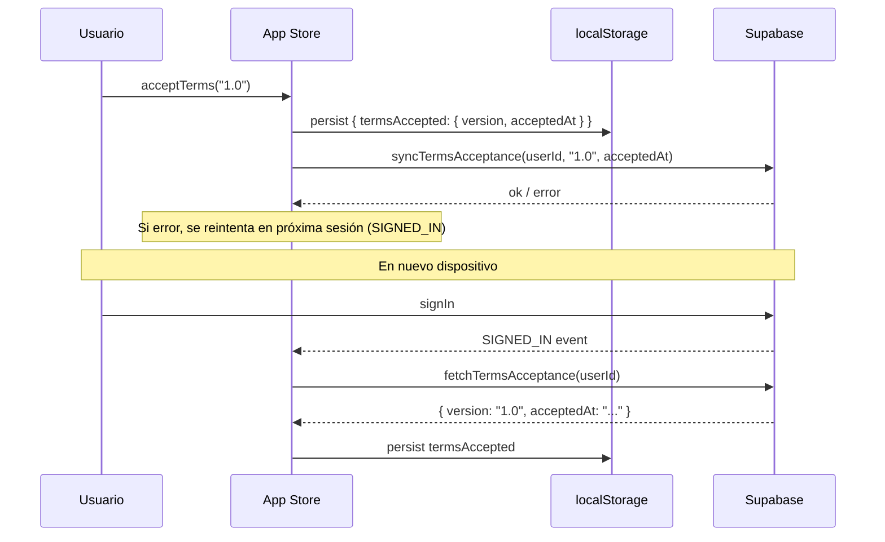

# Design Document: Terms and Conditions

## Overview

La feature de Términos y Condiciones es transversal a toda la app Proclama. Cubre dos flujos principales:

1. **Aceptación obligatoria**: mostrar los T&C antes de que el usuario pueda usar la app (registro con email, modo invitado, o cuando la versión de los términos cambia).
2. **Consulta libre**: permitir al usuario leer los T&C en cualquier momento desde `SettingsView`.

La aceptación se persiste en `localStorage` vía el store de Zustand y, cuando el usuario está autenticado, se sincroniza con la columna `terms_accepted_at` y `terms_version` de la tabla `profiles` en Supabase.

La versión vigente de los términos (`CURRENT_TERMS_VERSION`) se define como constante en el código. Cuando la versión aceptada difiere de la vigente, la app bloquea el acceso hasta que el usuario acepte la nueva versión.

---

## Architecture

```mermaid
flowchart TD
    A[App.tsx - AppContent] -->|authStatus + guestMode| B{¿Acceso permitido?}
    B -->|No autenticado y no guest| C[LandingView]
    B -->|Autenticado o guest| D{¿termsAccepted válido?}
    D -->|No o versión desactualizada| E[TermsModal - modo obligatorio]
    D -->|Sí| F[MainApp]

    C -->|Clic "Continuar sin cuenta"| E
    C -->|Clic "Crear Cuenta"| E2[TermsModal - flujo registro]

    E -->|Acepta| G[App_Store.acceptTerms]
    E2 -->|Acepta| G
    G -->|Usuario autenticado| H[Supabase profiles upsert]
    G -->|Siempre| I[localStorage via Zustand persist]

    F --> J[SettingsView]
    J -->|Clic "Términos y Condiciones"| K[TermsView - solo lectura]
```

### Decisiones de diseño

- **Sin nueva ruta**: `TermsView` se renderiza como vista dentro del shell existente (igual que `SettingsView`, `BibleView`, etc.), añadiendo `'terms'` al tipo `activeView` del store. Esto evita añadir un router y mantiene la arquitectura actual.
- **Un solo componente modal**: `TermsModal` se usa tanto en el flujo de registro/invitado como para la detección de versión actualizada. El prop `mode` controla si el botón de cierre está disponible.
- **Versión como constante**: `CURRENT_TERMS_VERSION = "1.0"` en un archivo de constantes. Cambiarla en el futuro dispara la re-aceptación automáticamente.
- **Sincronización optimista**: la aceptación se guarda primero en `localStorage` y luego se intenta sincronizar con Supabase. Si falla, se reintenta en la próxima sesión.

---

## Components and Interfaces

### Nuevos componentes

#### `src/components/TermsModal.tsx`

Modal que muestra el contenido completo de los T&C con checkbox de aceptación.

```typescript
interface TermsModalProps {
  mode: 'required' | 'optional'  // 'required' oculta el botón de cierre
  onAccept: () => void
  onClose: () => void
}
```

- `role="dialog"`, `aria-modal="true"`, `aria-labelledby="terms-modal-title"`
- Gestión de foco: al abrirse, foco en el título; al cerrarse, foco en el elemento que lo abrió
- Botón de cierre con `aria-label="Cerrar términos"` (visible solo en `mode='optional'`)
- Área de scroll con el contenido de los términos
- Checkbox: `id="terms-accept-checkbox"`, `aria-required="true"`
- Botón "Aceptar y continuar" deshabilitado hasta que el checkbox esté marcado

#### `src/pages/TermsView.tsx`

Vista de solo lectura de los T&C, accesible desde `SettingsView`.

- Muestra versión vigente y fecha de última actualización del documento
- Si existe `termsAccepted` en el store, muestra la fecha de aceptación del usuario
- Botón "Volver a Ajustes" que llama a `setActiveView('settings')`
- Usa iconos de `lucide-react` (ArrowLeft para volver)
- Responsive desde 320px

#### `src/components/TermsContent.tsx`

Componente puro que renderiza el texto de los T&C. Compartido entre `TermsModal` y `TermsView` para evitar duplicación.

```typescript
// Sin props — el contenido es estático y versionado en el código
export default function TermsContent() { ... }
```

### Modificaciones a componentes existentes

#### `src/stores/index.ts`

Añadir al `AppStore`:

```typescript
// Nuevo estado
termsAccepted: TermsAcceptance | null
acceptTerms: (version: string) => Promise<void>
checkTermsVersion: () => boolean  // true si necesita re-aceptar

// Nuevo tipo
interface TermsAcceptance {
  version: string       // ej. "1.0"
  acceptedAt: string    // ISO 8601
}
```

`termsAccepted` se añade al `partialize` del persist middleware para que sobreviva recargas.

`acceptTerms` guarda en el store y, si hay usuario autenticado, llama a `syncTermsAcceptance` en supabase.ts.

#### `src/App.tsx`

En `AppContent`, después de resolver `authStatus`, verificar si `checkTermsVersion()` retorna `true`. Si es así, renderizar `<TermsModal mode="required" />` bloqueando el acceso a `MainApp`.

En `AppContent`, al iniciar sesión (evento `SIGNED_IN`), llamar a `loadTermsFromSupabase(userId)` para sincronizar la aceptación remota.

#### `src/pages/LandingView.tsx`

El botón "Probar Gratis" / "Continuar sin cuenta" ya no llama directamente a `setGuestMode(true)`. En su lugar, abre `TermsModal` con `mode='required'`. Al aceptar, llama a `acceptTerms` y luego a `setGuestMode(true)`.

#### `src/pages/SettingsView.tsx`

El botón "Crear Cuenta" intercepta el submit del formulario de registro. Antes de llamar a `supabase.auth.signUp`, abre `TermsModal` con `mode='optional'`. Al aceptar, continúa con el registro.

Añadir enlace/botón "Términos y Condiciones" en la sección de cuenta que llama a `setActiveView('terms')`.

#### `src/types/index.ts`

Añadir `'terms'` al union type de `activeView` en `AppStore`.

### Constantes

#### `src/constants/terms.ts`

```typescript
export const CURRENT_TERMS_VERSION = "1.0"
export const TERMS_LAST_UPDATED = "2025-01-01"  // fecha de última actualización del documento
```

### Supabase

#### `src/services/supabase.ts`

Añadir dos funciones:

```typescript
// Guarda la aceptación en la tabla profiles
export async function syncTermsAcceptance(
  userId: string,
  version: string,
  acceptedAt: string
): Promise<boolean>

// Recupera la aceptación desde profiles
export async function fetchTermsAcceptance(
  userId: string
): Promise<{ version: string; acceptedAt: string } | null>
```

La tabla `profiles` ya existe. Se añaden las columnas:
- `terms_version: text` — versión aceptada
- `terms_accepted_at: timestamptz` — fecha de aceptación

---

## Data Models

### `TermsAcceptance` (frontend / localStorage)

```typescript
interface TermsAcceptance {
  version: string      // "1.0"
  acceptedAt: string   // ISO 8601, ej. "2025-01-15T10:30:00.000Z"
}
```

### Zustand store (partializado en localStorage)

El store persiste bajo la clave `'proclama-app'`. Se añade `termsAccepted` al `partialize`:

```typescript
partialize: (state) => ({
  settings: state.settings,
  isSidebarOpen: state.isSidebarOpen,
  onboardingDone: state.onboardingDone,
  guestMode: state.guestMode,
  termsAccepted: state.termsAccepted,   // NUEVO
})
```

### Supabase `profiles` table (nuevas columnas)

| Columna             | Tipo        | Nullable | Descripción                        |
|---------------------|-------------|----------|------------------------------------|
| `terms_version`     | `text`      | YES      | Versión de T&C aceptada            |
| `terms_accepted_at` | `timestamptz` | YES    | Timestamp de aceptación            |

### Flujo de sincronización



---

## Correctness Properties

*A property is a characteristic or behavior that should hold true across all valid executions of a system — essentially, a formal statement about what the system should do. Properties serve as the bridge between human-readable specifications and machine-verifiable correctness guarantees.*

### Property 1: Aceptación persiste en localStorage

*Para cualquier* versión de términos y fecha de aceptación, después de llamar a `acceptTerms`, el valor de `termsAccepted` en el store debe contener exactamente la versión y fecha proporcionadas.

**Validates: Requirements 1.4, 1.5, 2.3**

---

### Property 2: Botón deshabilitado sin checkbox

*Para cualquier* estado del modal de términos donde el checkbox no está marcado, el botón "Aceptar y continuar" debe estar deshabilitado (atributo `disabled` presente).

**Validates: Requirements 1.3, 2.2**

---

### Property 3: Bloqueo por versión desactualizada

*Para cualquier* `TermsAcceptance` cuya `version` sea diferente a `CURRENT_TERMS_VERSION`, la función `checkTermsVersion()` debe retornar `true` (indicando que se requiere re-aceptación).

**Validates: Requirements 4.1, 4.2, 4.3**

---

### Property 4: Actualización de versión en re-aceptación

*Para cualquier* `TermsAcceptance` preexistente con versión antigua, después de llamar a `acceptTerms(CURRENT_TERMS_VERSION)`, el store debe contener la nueva versión y una fecha de aceptación posterior a la anterior.

**Validates: Requirements 4.4**

---

### Property 5: Modo invitado no se activa sin aceptación

*Para cualquier* intento de activar el modo invitado, si el usuario cierra el modal sin aceptar, `guestMode` en el store debe permanecer `false`.

**Validates: Requirements 2.4**

---

### Property 6: TermsView muestra fecha de aceptación del usuario

*Para cualquier* `TermsAcceptance` registrada en el store, cuando se renderiza `TermsView`, el componente debe mostrar la fecha de aceptación formateada en el DOM.

**Validates: Requirements 3.4**

---

### Property 7: Sincronización round-trip con Supabase

*Para cualquier* objeto `TermsAcceptance` válido, serializar y guardar en Supabase mediante `syncTermsAcceptance` y luego recuperar con `fetchTermsAcceptance` debe producir un objeto equivalente (misma versión y fecha).

**Validates: Requirements 5.1, 5.2**

---

### Property 8: Fallo de sincronización preserva aceptación local

*Para cualquier* llamada a `acceptTerms` donde `syncTermsAcceptance` falla (simular error de red), el store debe conservar `termsAccepted` en localStorage con los valores correctos.

**Validates: Requirements 5.4**

---

## Error Handling

| Escenario | Comportamiento esperado |
|-----------|------------------------|
| `syncTermsAcceptance` falla (red) | Se conserva la aceptación en localStorage. Se marca un flag `termsSyncPending: true` en el store para reintentar en el próximo `SIGNED_IN`. |
| `fetchTermsAcceptance` falla al iniciar sesión | Se usa el valor de localStorage como fallback. Si no hay valor local, se muestra el modal de aceptación. |
| Usuario cierra `TermsModal` en modo `required` | El botón de cierre no está disponible. Solo se puede cerrar aceptando. |
| Usuario cierra `TermsModal` en modo `optional` (registro) | El modal se cierra, el proceso de registro no continúa. El formulario de registro permanece visible. |
| `CURRENT_TERMS_VERSION` no coincide con ninguna versión conocida | Se trata como versión nueva y se muestra el modal de re-aceptación. |

---

## Testing Strategy

### Enfoque dual

Se usan dos tipos de tests complementarios:

- **Unit tests**: verifican ejemplos concretos, casos borde y condiciones de error.
- **Property tests**: verifican propiedades universales sobre rangos de inputs generados.

La librería de property-based testing elegida es **fast-check** (compatible con Vitest, ampliamente usada en ecosistema TypeScript/React).

### Configuración de property tests

- Mínimo **100 iteraciones** por test de propiedad.
- Cada test referencia la propiedad del diseño con el tag:
  `// Feature: terms-and-conditions, Property N: <texto>`

### Tests unitarios (ejemplos y casos borde)

- Renderizado de `TermsModal` con `mode='required'`: verificar que el botón de cierre no aparece.
- Renderizado de `TermsModal` con `mode='optional'`: verificar que el botón de cierre aparece con `aria-label="Cerrar términos"`.
- `TermsView` sin `termsAccepted` en el store: no debe mostrar fecha de aceptación.
- `TermsView` con `termsAccepted` en el store: debe mostrar la fecha formateada.
- `checkTermsVersion()` con `termsAccepted = null`: debe retornar `true`.
- `checkTermsVersion()` con versión igual a `CURRENT_TERMS_VERSION`: debe retornar `false`.
- Accesibilidad: `TermsModal` debe tener `role="dialog"`, `aria-modal="true"`, `aria-labelledby`.

### Tests de propiedad (fast-check)

```typescript
// Feature: terms-and-conditions, Property 1: Aceptación persiste en localStorage
fc.assert(fc.asyncProperty(
  fc.string({ minLength: 1 }),  // versión arbitraria
  fc.date(),                     // fecha arbitraria
  async (version, date) => {
    const store = createTestStore()
    await store.getState().acceptTerms(version)
    const accepted = store.getState().termsAccepted
    return accepted?.version === version && accepted?.acceptedAt !== undefined
  }
), { numRuns: 100 })

// Feature: terms-and-conditions, Property 3: Bloqueo por versión desactualizada
fc.assert(fc.property(
  fc.string({ minLength: 1 }).filter(v => v !== CURRENT_TERMS_VERSION),
  (oldVersion) => {
    const store = createTestStore({ termsAccepted: { version: oldVersion, acceptedAt: new Date().toISOString() } })
    return store.getState().checkTermsVersion() === true
  }
), { numRuns: 100 })

// Feature: terms-and-conditions, Property 7: Sincronización round-trip con Supabase
fc.assert(fc.asyncProperty(
  fc.record({ version: fc.string({ minLength: 1 }), acceptedAt: fc.date().map(d => d.toISOString()) }),
  async (acceptance) => {
    await syncTermsAcceptance(TEST_USER_ID, acceptance.version, acceptance.acceptedAt)
    const fetched = await fetchTermsAcceptance(TEST_USER_ID)
    return fetched?.version === acceptance.version
  }
), { numRuns: 100 })
```

### Cobertura esperada

| Requisito | Tipo de test |
|-----------|-------------|
| 1.1 Modal aparece antes del registro | Unit (integración con SettingsView) |
| 1.2 Contenido completo + checkbox + botón | Unit (snapshot / queries) |
| 1.3 Botón deshabilitado sin checkbox | Property 2 |
| 1.4, 1.5 Persistencia en localStorage | Property 1 |
| 1.6 Cierre sin aceptar no registra | Unit |
| 2.1 Modal antes de modo invitado | Unit (integración con LandingView) |
| 2.2 Botón deshabilitado | Property 2 (compartida) |
| 2.3 Persistencia modo invitado | Property 1 (compartida) |
| 2.4 guestMode no se activa sin aceptar | Property 5 |
| 3.4 Fecha de aceptación en TermsView | Property 6 |
| 4.1–4.3 Bloqueo por versión | Property 3 |
| 4.4 Actualización de versión | Property 4 |
| 5.1, 5.2 Sincronización Supabase | Property 7 |
| 5.4 Fallo de sincronización | Property 8 |
| 6.2 Accesibilidad modal | Unit (aria queries) |
