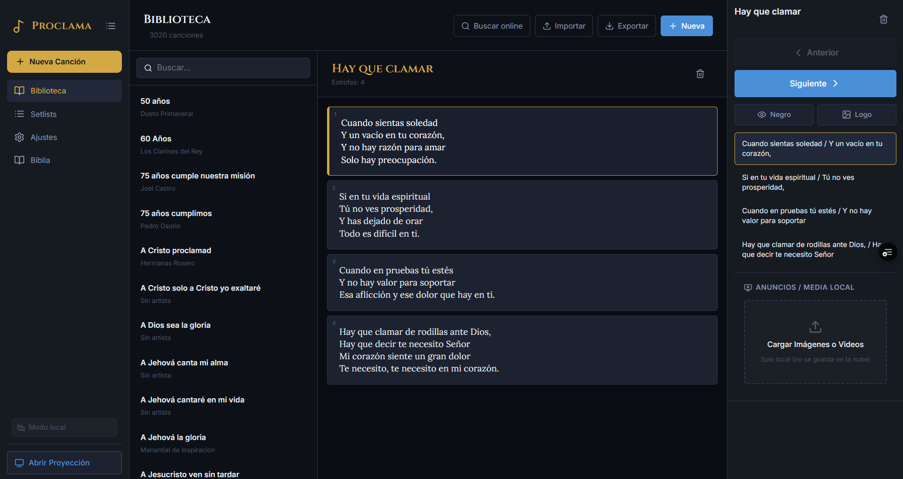
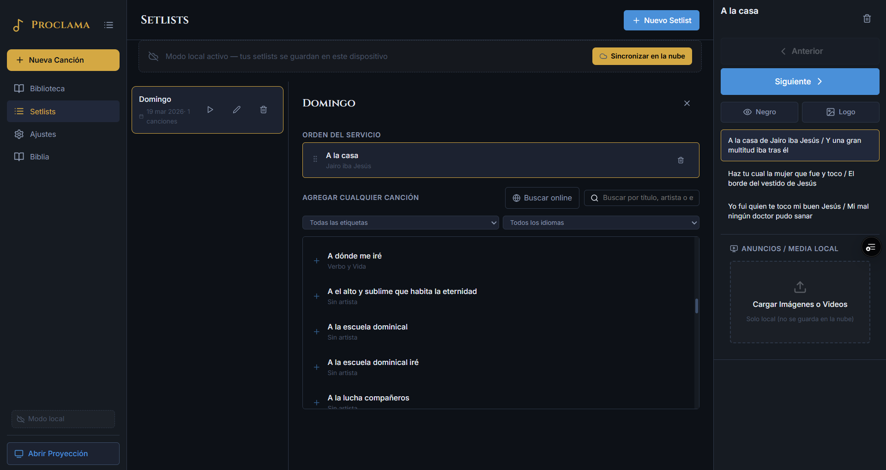
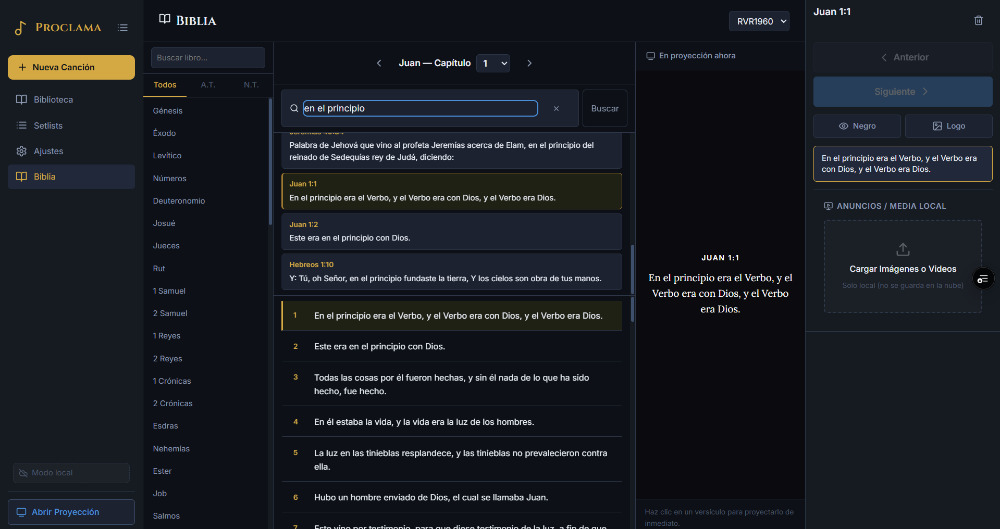
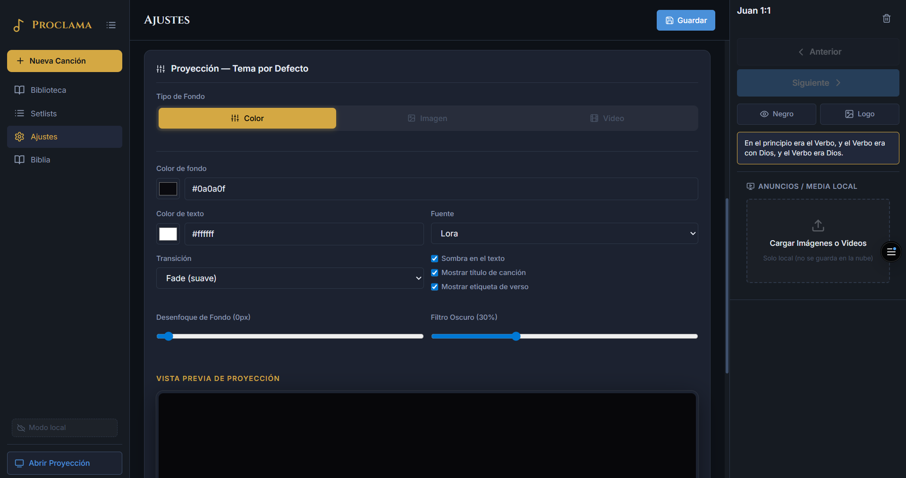

# Proclama

Sistema de proyección de alabanzas y Biblia para iglesias, construido con React, TypeScript y Vite.  
Está pensado para funcionar directamente en el navegador, con soporte para uso local, sincronización opcional en la nube y una ventana de proyección independiente.

## Resumen

Proclama reúne en una sola aplicación:

- Biblioteca de canciones con almacenamiento local y sincronización con Supabase.
- Creación y administración de setlists para servicios.
- Proyección en una ventana separada para TV o proyector.
- Biblia integrada con búsqueda por texto, libro o referencia.
- Fondos personalizables con color, imagen o video.
- Importación, exportación y búsqueda online de letras.
- Panel de control en vivo con navegación rápida de estrofas y versículos.

## Cambios Más Importantes Realizados

- Se eliminó la dependencia de una landing page inicial para entrar a la aplicación más rápido.
- Ya no es obligatorio iniciar sesión para usar Proclama: ahora puede trabajarse en modo local desde el primer momento.
- Se mantuvo el inicio de sesión con Supabase como opción para habilitar escritura sincronizada y uso en la nube.
- Se añadió un flujo de onboarding guiado para nuevos usuarios dentro de la aplicación.
- Se incorporó un `ConfirmDialog` para acciones sensibles como eliminaciones.
- Se mejoró la accesibilidad con mejores etiquetas ARIA, estados interactivos más claros y navegación más segura.
- Se consolidó la gestión de setlists con soporte local y cloud.
- Se integró la búsqueda y proyección de pasajes bíblicos dentro de la misma interfaz.
- Se reforzó el panel de media local para anuncios temporales, imágenes y videos.
- Se mantuvo la arquitectura base con Zustand para estado global, Dexie para persistencia local y Supabase para sincronización/autenticación.

## Funcionalidades Principales

### Biblioteca de canciones

- Crear, editar, cargar y eliminar canciones.
- Buscar por título, artista, letra y etiquetas.
- Importar y exportar la biblioteca en JSON.
- Buscar letras online e incorporarlas al flujo de trabajo.
- Persistencia local con Dexie para trabajar incluso si no hay sesión activa.



### Setlists

- Crear setlists para cada servicio o reunión.
- Agregar canciones desde la biblioteca local.
- Reordenar canciones con drag and drop.
- Activar una canción directamente desde el setlist.
- Guardado local sin cuenta y sincronización en Supabase cuando hay sesión iniciada.



### Biblia integrada

- Navegación por libros y capítulos.
- Búsqueda global por texto o referencia, por ejemplo `Juan 3:16`.
- Proyección inmediata de un versículo o pasaje.
- Vista previa del contenido que está en proyección.



### Proyección en vivo

- Apertura de ventana independiente para proyector o segunda pantalla.
- Navegación entre estrofas y versículos.
- Pantalla negra y logo de iglesia.
- Tema configurable en tiempo real.
- Soporte de fondos por color, imagen y video.



### Media y personalización

- Carga de imágenes y videos locales para anuncios o fondos temporales.
- Control de reproducción de video en la proyección.
- Vista previa del tema desde ajustes.
- Configuración de tipografía, tamaño, sombra, color y transición.

### Onboarding y UX

- Tour guiado para explicar los puntos clave de la app al primer uso.
- Confirmaciones antes de acciones destructivas.
- Mejoras recientes de accesibilidad para diálogos, botones y navegación.

## Tecnologías

- Frontend: React 18, TypeScript, Vite.
- Estado global: Zustand.
- Base local: Dexie.
- Autenticación y nube: Supabase.
- UI e iconografía: CSS personalizado y Lucide React.
- PWA: `vite-plugin-pwa`.
- Reordenamiento drag and drop: `@dnd-kit`.

## Estructura General

- `src/pages`: vistas principales como biblioteca, Biblia, setlists y ajustes.
- `src/components`: componentes reutilizables como paneles, diálogos y onboarding.
- `src/stores`: estado global de aplicación y proyección.
- `src/services`: integración con Supabase, Biblia, proyección y búsqueda de letras.
- `src/db`: persistencia local con Dexie.

## Instalación

```bash
git clone https://github.com/tu-usuario/proclama.git
cd proclama
npm install
```

## Variables de Entorno

Crea un archivo `.env.local` con:

```bash
VITE_SUPABASE_URL=tu_url_de_supabase
VITE_SUPABASE_ANON_KEY=tu_anon_key
```

Notas:

- Supabase es necesario para autenticación y sincronización cloud.
- La app puede usarse sin login para flujo local.
- El token de Genius se configura desde la pantalla de ajustes, no desde `.env`.

## Scripts

```bash
npm run dev
npm run build
npm run preview
```

## Atajos de Teclado

| Tecla | Acción |
|-------|--------|
| `→` / `↓` / `Espacio` | Siguiente estrofa o versículo |
| `←` / `↑` | Estrofa o versículo anterior |
| `B` | Activar o desactivar pantalla negra |
| `Esc` | Cerrar modales o salir del modo negro |

## Estado Actual Del Proyecto

Actualmente Proclama ya cuenta con una base sólida de uso real:

- aplicación principal sin bloqueo por autenticación,
- biblioteca local y sincronizada,
- setlists editables,
- Biblia integrada,
- proyección separada,
- media local,
- personalización visual,
- onboarding,
- mejoras de accesibilidad.

## Propósito

Proclama busca ofrecer una herramienta moderna, ligera y accesible para la proyección en iglesias, reduciendo barreras de costo y permitiendo un flujo de trabajo simple desde el navegador.

Hecho con amor para servir al Reino de Dios.
